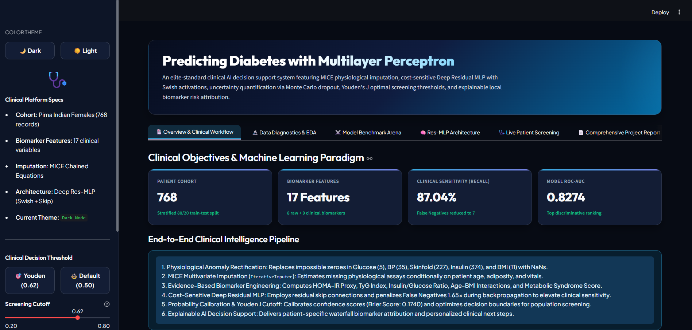
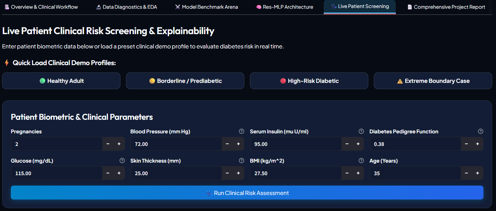
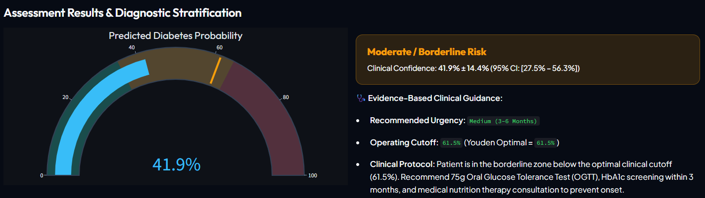
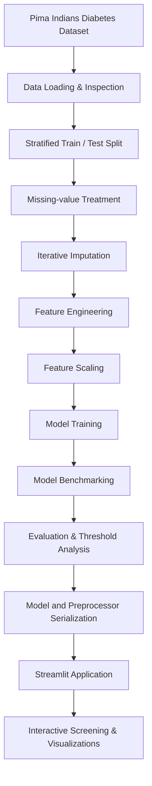
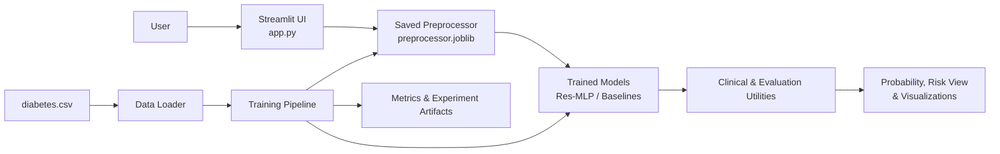

<div align="center">

# DiabPredict — Diabetes Risk Prediction

### An end-to-end Machine Learning & Deep Learning application for exploratory diabetes risk screening

<p>
  
  
  
  
  
</p>

<p>
  <a href="#overview">Overview</a> ·
  <a href="#application-preview">Application Preview</a> ·
  <a href="#features">Features</a> ·
  <a href="#system-architecture">Architecture</a> ·
  <a href="#model-performance">Results</a> ·
  <a href="#getting-started">Get Started</a>
</p>

</div>

---

## Table of Contents

- [Overview](#overview)
- [Application Preview](#application-preview)
- [Key Features](#key-features)
- [Dataset](#dataset)
- [Machine Learning Workflow](#machine-learning-workflow)
- [System Architecture](#system-architecture)
- [Model Development](#model-development)
- [Model Performance](#model-performance)
- [Repository Structure](#repository-structure)
- [Getting Started](#getting-started)
- [Run the Streamlit Application](#run-the-streamlit-application)
- [Train and Evaluate Models](#train-and-evaluate-models)
- [Saved Model Artifacts](#saved-model-artifacts)
- [Technology Stack](#technology-stack)
- [Limitations and Responsible Use](#limitations-and-responsible-use)
- [Future Enhancements](#future-enhancements)
- [Author](#author)

---

## Overview

**DiabPredict** is an end-to-end machine learning and deep learning project that explores diabetes outcome prediction from structured clinical measurements. The project combines traditional machine learning classifiers with a TensorFlow/Keras **Residual Multilayer Perceptron (Res-MLP)** and provides an interactive **Streamlit** application for exploratory patient-level screening.

The repository demonstrates a complete applied ML workflow:

- Dataset loading, inspection and exploratory analysis
- Handling of zero-coded missing measurements
- Multivariate imputation and feature engineering
- Training and comparison of traditional ML models
- Development of a residual neural network
- Evaluation using classification and probability metrics
- Model persistence and inference through a web application

> **Important:** DiabPredict is an academic and portfolio project. It is not a medical device, does not provide a diagnosis, and must not be used to make treatment decisions. Any health concern should be discussed with a qualified healthcare professional.

## Application Preview

The following screenshots are stored in the repository's `assets/` directory and are embedded directly from their relative paths. GitHub will render them automatically when the image files are committed.

### Dashboard

<p align="center">
  
</p>

### Live Patient Screening

<p align="center">
  
</p>

### Predicted Diabetes Probability

<p align="center">
  
</p>

## Key Features

| Feature | Description |
|---|---|
| Interactive dashboard | Streamlit interface for exploring the project and its workflow |
| Exploratory data analysis | Dataset diagnostics, distributions and feature exploration |
| Multiple ML classifiers | Benchmarking of five conventional classification algorithms |
| Deep learning model | Residual MLP built with TensorFlow/Keras |
| Data preprocessing | Zero-value handling, iterative imputation, feature engineering and scaling |
| Probability-based screening | Model-generated probability with a configurable classification threshold |
| Model comparison | Side-by-side evaluation using accuracy, precision, recall, F1-score and ROC-AUC |
| Explainability utilities | Feature-importance and risk-explanation components |
| Saved artifacts | Persisted models, preprocessing objects, metrics and experiment outputs |

## Dataset

The project uses the **Pima Indians Diabetes Database**, stored locally at `data/diabetes.csv`.

| Dataset property | Value |
|---|---:|
| Total observations | 768 |
| Input features | 8 |
| Target column | `Outcome` |
| Non-diabetic records (`0`) | 500 (65.1%) |
| Diabetic records (`1`) | 268 (34.9%) |

### Input features

| Feature | Description |
|---|---|
| `Pregnancies` | Number of pregnancies |
| `Glucose` | Plasma glucose concentration (mg/dL) |
| `BloodPressure` | Diastolic blood pressure (mm Hg) |
| `SkinThickness` | Triceps skin-fold thickness (mm) |
| `Insulin` | Serum insulin measurement (µU/mL) |
| `BMI` | Body mass index (kg/m²) |
| `DiabetesPedigreeFunction` | Diabetes pedigree function score |
| `Age` | Age in years |

### Missing-value treatment

The source data encodes some unavailable measurements as zero. The preprocessing pipeline treats zero values in `Glucose`, `BloodPressure`, `SkinThickness`, `Insulin` and `BMI` as missing before applying an iterative imputation strategy.

This is a dataset-specific assumption. Zero is not universally an invalid value for every clinical variable, so this treatment should not be transferred to other datasets without reviewing their data definitions.

## Machine Learning Workflow



### Preprocessing pipeline

Implemented primarily in `src/preprocessor.py`:

1. Select and order the eight input features.
2. Convert selected zero-coded measurements into missing values.
3. Apply iterative multivariate imputation.
4. Generate derived features and feature interactions.
5. Apply scaling transformations.
6. Reuse the fitted preprocessing object when preparing application inputs.

The feature-engineering stage expands the original eight inputs into a larger feature representation (17 features in the saved model workflow). These transformations are experimental model features, not independently validated clinical biomarkers.

## System Architecture

The application separates the user interface, model development code, saved artifacts and input dataset.



### Main application sections

The Streamlit interface contains six main sections:

1. **Overview & Clinical Workflow** — project objective and end-to-end workflow.
2. **Data Diagnostics & EDA** — dataset inspection and exploratory analysis.
3. **Model Benchmark Arena** — comparison of traditional ML models and the neural model.
4. **Res-MLP Architecture** — neural-network architecture and training analysis.
5. **Live Patient Screening** — interactive input form and model-generated probability.
6. **Comprehensive Project Report** — methodology and academic project documentation.

## Model Development

### Traditional machine learning models

The benchmark pipeline includes:

- Logistic Regression
- K-Nearest Neighbors (KNN)
- Support Vector Machine (SVM)
- Random Forest
- Gradient Boosting

### Deep learning: Residual MLP

The primary neural network is implemented in `src/mlp_model.py` using TensorFlow/Keras.

High-level architecture:

```text
17 Engineered Input Features
          │
          ▼
Dense Layer (64 units, Swish)
          │
          ▼
Batch Normalization + Dropout
          │
          ▼
Residual Block
  ├── Dense (64 units)
  ├── Batch Normalization
  ├── Dropout
  └── Skip Connection
          │
          ▼
Dense Layer (32 units, Swish)
          │
          ▼
Batch Normalization + Dropout
          │
          ▼
Dense Output (1 unit, Sigmoid)
          │
          ▼
Predicted Probability
```

The implementation uses binary classification, a sigmoid output, regularization and training callbacks. The exact saved model and preprocessing artifacts are provided in `models/`.

## Model Performance

The following results are transcribed from `models/model_comparison.csv`. They describe the saved experiment and should be interpreted in the context of its dataset and evaluation procedure.

| Model | Accuracy | Precision | Recall | F1-score | ROC-AUC |
|---|---:|---:|---:|---:|---:|
| Logistic Regression | 70.13% | 58.70% | 50.00% | 0.5400 | 0.8194 |
| K-Nearest Neighbors | 75.32% | 64.81% | 64.81% | 0.6481 | 0.7773 |
| Support Vector Machine | 73.38% | 64.44% | 53.70% | 0.5859 | 0.7789 |
| Random Forest | 70.78% | 59.57% | 51.85% | 0.5545 | 0.8111 |
| Gradient Boosting | 72.73% | 62.00% | 57.41% | 0.5962 | 0.8081 |
| Res-MLP (threshold 0.50) | 74.03% | 58.97% | 85.19% | 0.6970 | 0.8300 |
| Res-MLP (Youden threshold ≈ 0.62) | **77.27%** | **64.62%** | 77.78% | **0.7059** | 0.8300 |

### Understanding the threshold trade-off

The saved comparison includes two operating points for the Res-MLP:

- At threshold `0.50`, recall is higher (85.19%), with 8 false negatives and 32 false positives.
- At threshold approximately `0.62`, accuracy and F1-score are higher, with 12 false negatives and 23 false positives.

A lower threshold can identify more positive cases but may also increase false positives. Threshold selection should be driven by the intended use case and evaluated on data that was not used to select the threshold.

### Evaluation caveat

**The threshold-specific results are exploratory, not an unbiased final test estimate.** In the current training pipeline, the Youden threshold is selected using predictions and labels from the same holdout test set used for reporting performance. This introduces test-set information into threshold selection and can make the selected-threshold metrics optimistic.

For a rigorous evaluation, select the threshold using a validation set or cross-validation, freeze the model and threshold, and evaluate once on a separate untouched test set. The current training code also creates a validation subset for neural-network tuning and training; the final training/evaluation workflow should be reviewed and updated before treating the saved figures as final research results.

## Repository Structure

```text
DiabetesPrediction/
│
├── assets/
│   ├── dashboard.png
│   ├── LivePatientScreening.png
│   └── PredictedDiabetesProbability.png
│
├── data/
│   └── diabetes.csv
│
├── models/
│   ├── all_metrics.json
│   ├── baseline_models.joblib
│   ├── clinical_thresholds.json
│   ├── diabetes_mlp.keras
│   ├── feature_importance.json
│   ├── hyperparameter_tuning.csv
│   ├── mlp_history.json
│   ├── model_comparison.csv
│   └── preprocessor.joblib
│
├── notebooks/
│   └── diabetes_prediction.ipynb
│
├── src/
│   ├── __init__.py
│   ├── baseline_models.py
│   ├── clinical_engine.py
│   ├── data_loader.py
│   ├── generate_notebook.py
│   ├── mlp_model.py
│   ├── preprocessor.py
│   ├── test_deployed_model.py
│   └── train_pipeline.py
│
├── .gitignore
├── app.py
├── README.md
└── requirements.txt
```

> Python cache folders such as `__pycache__/` are intentionally omitted from the documented structure and should remain excluded from version control.

## Getting Started

### Prerequisites

- Python installed (use a version compatible with the TensorFlow release in your environment).
- Git.
- pip.
- A supported operating system for TensorFlow.

### 1. Clone the repository

```bash
git clone https://github.com/<YOUR-GITHUB-USERNAME>/DiabetesPrediction.git
cd DiabetesPrediction
```

Replace `<YOUR-GITHUB-USERNAME>` with your GitHub username and adjust the repository name if needed.

### 2. Create a virtual environment

**Windows PowerShell:**

```powershell
py -m venv .venv
.\.venv\Scripts\Activate.ps1
```

**macOS / Linux:**

```bash
python3 -m venv .venv
source .venv/bin/activate
```

### 3. Install dependencies

```bash
python -m pip install --upgrade pip
pip install -r requirements.txt
```

If TensorFlow installation fails, check the official TensorFlow installation documentation for a Python and platform combination supported by the version you intend to install.

## Run the Streamlit Application

From the project root directory:

```bash
streamlit run app.py
```

Streamlit will display a local URL in the terminal, usually:

```text
http://localhost:8501
```

Open that address in your browser.

## Train and Evaluate Models

To run the training pipeline from the project root:

```bash
python -m src.train_pipeline
```

The pipeline reads `data/diabetes.csv` and writes the generated model and evaluation artifacts into `models/`.

**Note:** Training can take longer than launching the application. It may overwrite saved artifacts, so back up existing model files before running it if you want to preserve the current experiment.

## Saved Model Artifacts

| File | Purpose |
|---|---|
| `diabetes_mlp.keras` | Saved TensorFlow/Keras neural network |
| `baseline_models.joblib` | Serialized traditional ML models |
| `preprocessor.joblib` | Fitted preprocessing and feature-transformation object |
| `model_comparison.csv` | Model benchmark results |
| `all_metrics.json` | Detailed evaluation metrics |
| `clinical_thresholds.json` | Saved threshold and calibration-related information |
| `feature_importance.json` | Feature-importance values |
| `hyperparameter_tuning.csv` | Hyperparameter/architecture experiment results |
| `mlp_history.json` | Neural-network training history |

The preprocessing artifact must be used with the model it was trained alongside. Do not independently change feature order, preprocessing logic or model files without retraining and validating the complete pipeline.

## Technology Stack

| Area | Technologies |
|---|---|
| Programming language | Python |
| Data processing | NumPy, Pandas |
| Machine learning | scikit-learn |
| Deep learning | TensorFlow, Keras |
| Web application | Streamlit |
| Visualization | Plotly |
| Model persistence | Joblib, Keras model serialization |
| Experimentation | Jupyter Notebook |

## Limitations and Responsible Use

- This project uses a relatively small, historical dataset and may not generalize to other populations or clinical settings.
- Dataset measurements and missing-value conventions must be understood before applying the pipeline to another dataset.
- The engineered features are experimental transformations. They should not be described as validated clinical biomarkers without appropriate evidence.
- The current threshold-selection workflow uses the holdout test labels to select an operating threshold; this must be corrected for a rigorous final evaluation.
- Reported metrics are dataset-specific and do not establish clinical effectiveness, safety or calibration in real-world populations.
- Model-generated probabilities are not equivalent to an individual's clinically established probability of developing diabetes.
- This application is intended for education, experimentation and demonstration—not diagnosis or treatment.

## Future Enhancements

- Rework model selection and threshold tuning using stratified cross-validation and a separate validation set.
- Add external validation on an independent and appropriately governed dataset.
- Compare additional tabular models, including XGBoost or other gradient-boosting approaches where appropriate.
- Improve probability calibration and evaluate calibration on untouched data.
- Add robust automated tests for preprocessing, inference and input validation.
- Improve explainability with validated feature-attribution methods.
- Add reproducible experiment configuration, dependency pinning and model/data versioning.
- Deploy the application with appropriate privacy, security and responsible-use controls.

## Author

**Your Name**

- GitHub: [@YOUR-GITHUB-USERNAME](https://github.com/Anubhab47677)
- LinkedIn: [Add your LinkedIn profile](https://www.linkedin.com/in/anubhab-samantaray/)

---

<div align="center">

**DiabPredict — Exploring Machine Learning for Diabetes Risk Screening**

If you find this project useful for learning or experimentation, consider giving the repository a ⭐.

</div>
